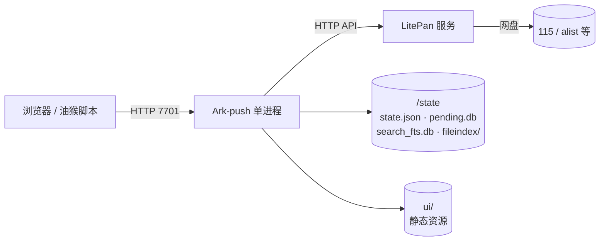

# Ark-push

> **LitePan 的边车服务（Rust 重写版）** · 不依赖 Meilisearch · 单二进制 · 单端口 `7701`
>
> 当前版本：`0.1.33`

Ark-push 是 `Arkpan-push` 的 Rust 重写实现。它保留 LitePan 边车的完整工作流——搜索、离线推送、STRM 管理、演员资料、备份——但**移除了 Meilisearch 进程和 `/meili_data` 数据卷**，把全文检索换成进程内嵌的 SQLite FTS5 索引。

它只通过 LitePan 的 HTTP API 与 LitePan 交互，**不修改 LitePan 镜像、数据库或配置文件**，可以作为独立容器旁挂在既有 LitePan 旁边。

---

## 为什么重写

| 维度 | 旧版（Python + Meilisearch） | Ark-push（Rust） |
|------|------------------------------|------------------|
| 进程 | 主进程 + Meilisearch + supervisord | 单一 Rust 进程 |
| 搜索 | Meilisearch HTTP 服务 | SQLite FTS5（trigram）内嵌索引 |
| 空载内存 | 约 500 MB（其中 Meili 约 385 MB） | 约 6–10 MB |
| 部署 | 多容器 / 多端口 | 单容器 / 单端口 `7701` |
| 数据卷 | `state` + `meili_data` | 仅 `/state` |
| 构建产物 | Python 环境 + 依赖 | 单个静态链接二进制 |

---

## 功能特性

### 已实现

- **统一 HTTP 服务**：工作台静态页、播放器、油猴脚本、插件 SDK 均从 `7701` 端口提供
- **认证**：PBKDF2-SHA256（20 万次迭代）、HttpOnly `lps_session` Cookie、`X-Auth-Token`、`X-Ark-Key`
- **LitePan 客户端**：登录与 Cookie 持久化、401 自动重登、账号选择、目录列举、路径解析、离线任务、STRM 生成、上传/下载/流式播放、文件增删改查
- **推送作业**：`/api/push` → 登录 → 选账号 → 能力探测 → 解析目录 → 提交离线 → 登记待生成；支持 115 错误码 `10008` 重复任务复用
- **待生成管理**：SQLite `pending.db`，显式生成、落盘核对、自动清理
- **内嵌搜索**：SQLite FTS5 + trigram tokenizer，支持拼音别名、`filter`、`sort`、`highlight`、`facets`；索引落盘 `search_fts.db`，可重建
- **文件索引**：真实账号 BFS 遍历（目录 + 文件 ID），JSON 持久化，供 Ark 搜索 / 找片 / 演员目录匹配使用
- **演员模块**：javxy 头像与资料、演员桶排序、根父目录探测、精确目录优先
- **备份兼容**：兼容原版 PBKDF2 + HMAC-SHA256-CTR + Encrypt-then-MAC 信封格式，可导入导出旧版备份
- **CLI**：`serve`、`sync`、`link`、`doctor`、`probe`、`push`、`plugins`
- **自动化**：定时调度 STRM 任务、重启后按 btih 恢复本片任务、自动清理 / 改名 / STRM

### 已移除

- Meilisearch 进程、`/meili_data` 卷、`MEILI_*` 配置项、search-only key
- supervisord（Rust 主进程直接运行）
- 对 Meilisearch 的 HTTP 依赖

---

## 架构



全部状态集中在 `/state` 目录。索引属于派生数据，删除后可在设置页或 CLI 中重建。

---

## 快速开始

```bash
# 1. 进入项目目录
cd Ark-push

# 2. 启动（默认拉取 GHCR 预构建镜像）
docker compose up -d

# 3. 打开 http://<NAS-IP>:7701
```

默认账号 `admin` / `admin`。**登录后请立即到「设置 → 账号与安全」修改密码。**

完整的安装、配置与排错说明见 **[INSTALL.md](./INSTALL.md)**。

---

## 安装方式一览

### 1. Docker Compose（推荐，拉取 GHCR 镜像）

仓库根目录的 `docker-compose.yml` 默认从 GHCR 拉取预构建镜像，完整模板如下：

```yaml
services:
  ark-push:
    image: ghcr.io/ouyangyouzi/ark-push:latest
    # build: .   # 想本地编译时才取消注释，并把 image 改成 ark-push:local
    container_name: ark-push
    restart: unless-stopped
    ports:
      - "7701:7701"
    environment:
      - TZ=Asia/Shanghai
      - LINK_115=off
      - LITEPAN_URL=https://<你的LitePan域名>:<端口>
      - LITEPAN_INSECURE=on
      - STATE_DIR=/state
      - STRM_ROOT=/src
      - LOG_LEVEL=info
    volumes:
      - ./data/state:/state
```

```bash
docker compose up -d
```

这个 `image` 就是**远程拉取地址**（含仓库路径 `ouyangyouzi/ark-push`），Compose 会直接从 GHCR 拉取，不会在本机编译。想换成自己 fork 的镜像，把这一行改成 `ghcr.io/<你的用户名>/<仓库名>:latest` 即可。容器通过 `LITEPAN_URL` 用网络访问 LitePan 后端，改成你自己的地址即可；自签证书需 `LITEPAN_INSECURE=on`。

- 若报 `401 Unauthorized` / `denied`：先 `docker login ghcr.io`，或到仓库 **Packages → ark-push → Package settings → Change visibility → Public**。

workflow 会自动推送这几个标签：

```text
ghcr.io/ouyangyouzi/ark-push:latest
ghcr.io/ouyangyouzi/ark-push:main
ghcr.io/ouyangyouzi/ark-push:sha-<提交哈希>
```

### 2. 从源码本地构建

若想自己编译，把 `docker-compose.yml` 里的 `build: .` 取消注释，并把 `image` 改成本地名：

```yaml
image: ark-push:local
build: .
```

```bash
docker compose up -d --build
```

### 3. 从源码本地运行

```bash
cargo run --release -- serve
```

需要准备 `STATE_DIR`、`UI_DIR`、`LITEPAN_URL` 等环境变量，或在启动后的设置页中填写。需要 Rust 1.90+。

### 4. 开发模式（热重载）

```bash
docker compose -f docker-compose.dev.yml up -d --build
# 访问 http://<NAS-IP>:17701
```

开发容器把整个项目目录挂载到 `/app`，`src/*.rs` 改动由 `cargo watch --poll` 自动重编译重启，`ui/*` 改动刷新浏览器即生效。首次启动需编译依赖，CPU 会短暂升高。

---

## 配置

### 环境变量

所有配置均可通过环境变量设置，其中 LitePan 地址 / 账号 / 密码也可以在「设置 → 连接」页中保存（会写入 `/state/state.json`）。

完整模板见 **[.env.example](./.env.example)**，核心项如下：

| 变量 | 默认值 | 说明 |
|------|--------|------|
| `HTTP_PORT` | `7701` | HTTP 监听端口 |
| `STATE_DIR` | `/state` | 状态与索引目录 |
| `STRM_ROOT` | `/src` | 本地 STRM / 海报根目录 |
| `UI_DIR` | `/app/ui` | 静态资源目录 |
| `LITEPAN_URL` | `https://<你的LitePan域名>:<端口>` | LitePan 后端地址（容器通过网络访问，改成你的实际地址） |
| `LITEPAN_INSECURE` | `off` | 自签证书 HTTPS 设为 `on` |
| `LITEPAN_USERNAME` | `admin` | LitePan 登录账号 |
| `LITEPAN_PASSWORD` | 空 | LitePan 登录密码 |
| `LITEPAN_INSECURE` | `off` | 自签证书时忽略 TLS 校验 |
| `LINK_115` | `off` | 115 直链开关 |
| `LINK_ENABLED` | `on` | STRM 任务定时调度开关 |
| `PUSH_ALLOW_ANON` | `off` | 是否允许匿名推送 |
| `SYNC_INTERVAL_MIN` | `10` | 索引同步间隔（分钟） |
| `LINK_INTERVAL_MIN` | `60` | STRM 任务间隔（分钟） |
| `OFFLINE_TIMEOUT_MIN` | `120` | 离线任务超时（分钟） |
| `NETDISK_MAX_DIRS` | `20000` | 网盘 BFS 最大目录数 |
| `CACHE_DIR` | 空（`<STATE_DIR>/cache`） | 缓存目录 |
| `ACTOR_AVATAR_DIR` | 空（`<STATE_DIR>/avatars`） | 演员头像目录 |
| `LOG_LEVEL` | `info` | 日志级别 |
| `TZ` | `Asia/Shanghai` | 时区 |
| `PLUGINS_ENABLED` | `off` | 插件系统（Rust 版未启用） |

布尔值支持 `1` / `true` / `on` / `yes` / `y`。

### 数据卷

```yaml
volumes:
  - ./data/state:/state
```

`/state` 中保存：

- `state.json` — 设置、会话、认证信息
- `pending.db` — 待生成任务（SQLite）
- `search_fts.db` — 全文索引（SQLite FTS5）
- `fileindex/` — 文件与目录索引
- `creds/` — LitePan Cookie 凭据
- `cache/`、`avatars/` — 可选缓存与头像

索引为派生数据，可安全删除后重建；`state.json` 与 `pending.db` 建议纳入备份。

---

## CLI 命令

```bash
ark-push serve                 # 启动 HTTP 服务（默认命令）
ark-push sync [--full]         # 一次性索引同步
ark-push link [--dry-run]      # 触发 LitePan STRM 任务
ark-push doctor                # 健康检查（STRM 目录、索引、LitePan 登录）
ark-push probe                 # 打印 LitePan 能力探测结果
ark-push push --magnet <URL> [--target <路径>] [--file-name <名称>] \
              [--username <用户>] [--password <密码>]
ark-push plugins list          # 插件列表（兼容性占位）
```

在容器中可通过 `docker compose exec ark-push ark-push doctor` 调用。

---

## HTTP API 概览

接口同时提供 `/xxx` 与 `/api/xxx` 两种路径（兼容旧版前端）。

| 分组 | 代表接口 |
|------|----------|
| 认证 | `/api/auth/login`、`/api/auth/logout`、`/api/auth/session`、`/api/auth/update` |
| 搜索 | `/api/search`、`/search`、`/api/stats` |
| 推送 | `/api/push`、`/api/push/{id}`、`/api/jobs` |
| 待生成 | `/api/pending`、`/api/pending/generate`、`/api/pending/verify` |
| LitePan | `/api/litepan/accounts`、`/api/litepan/list`、`/api/litepan/offline`、`/api/litepan/strm-generate`、`/api/litepan/play` |
| Ark | `/api/ark/search`、`/api/ark/find-by-code`、`/api/ark/rename`、`/api/ark/resolve` |
| 演员 | `/api/actors`、`/api/actor/ranking`、`/api/actor-cache/*`、`/avatar/{file}` |
| 备份 | `/api/backup/export`、`/api/backup/import` |
| 系统 | `/health`、`/api/config`、`/api/settings`、`/api/runtime/*` |

完整路由见 `src/server.rs` 的 `build_router()`。

---

## 与旧版的行为差异

1. **搜索后端**：不再使用 Meili 的 `words/typo/proximity/attribute/exactness` 排序，改为 SQLite FTS5 trigram + BM25。功能入口保留，排序结果可能与旧版不完全一致。
2. **中文分词**：FTS5 trigram 支持中文子串与长文件名匹配，拼音作为别名写入索引；没有 Charabia 的词级分词。
3. **错字容忍**：中文错字能力弱于 Meili；拉丁词可用 LIKE 兜底。
4. **HTTP**：使用 HTTP/1.1 keep-alive，替代原版 `ThreadingHTTPServer` 的 HTTP/1.0 短连接。
5. **索引文件**：`/state/search_fts.db` 取代 Meili 数据目录。

---

## 当前版本的边界

以下模块保留了 API 入口与兼容的请求/响应结构，但尚未完整移植，后续可按模块补齐而不改变前端：

- **插件中心**：`/api/plugins/*` 返回空列表，Python 插件 worker 未接入
- **海报生成**：`/api/poster/generate` 返回未启用提示；本地扫描与目录接口可用
- **演员头像 / 资料**：已接入 javxy；gfriends / javbus 兜底未接入，javxy 不可达时显示占位
- **演员缓存扫描**：`/api/actor-cache/scan` 仅返回已接收，尚未逐目录建立影片索引
- **Emby**：`/api/emby/*` 返回未配置
- **整理改名**：仅提取番号与基础生成，尚未完整移植 `organize.py` 的垃圾判定与改名计划

---

## 目录结构

```text
Ark-push/
├─ src/
│  ├─ main.rs          CLI / 启动 / 调度
│  ├─ server.rs        路由与 handler
│  ├─ litepan.rs       LitePan 客户端与连接池
│  ├─ search.rs        搜索查询 / 排序 / 高亮 / facets
│  ├─ search_fts.rs    SQLite FTS5 索引实现
│  ├─ indexer.rs       STRM / 网盘文档构建与同步
│  ├─ fileindex.rs     文件 + 目录 BFS 索引
│  ├─ pending.rs       SQLite 待生成登记
│  ├─ jobs.rs          推送作业状态机
│  ├─ actors.rs        演员资料与目录匹配
│  ├─ organize.rs      整理 / 改名逻辑
│  ├─ auth.rs          PBKDF2 / 会话
│  ├─ state.rs         state.json / creds
│  ├─ backup.rs        兼容旧版加密备份
│  ├─ config.rs        环境变量配置
│  └─ util.rs          原子写 / 路径 / 归一化
├─ ui/                  原版工作台静态资源
├─ Dockerfile           多阶段构建
├─ docker-compose.yml   生产 Compose 模板
├─ docker-compose.dev.yml 开发模式 Compose
├─ INSTALL.md           安装与部署指南
└─ .env.example         环境变量模板
```

---

## 许可

仅限个人学习与自用，跟随上游 LitePan 项目用途。
